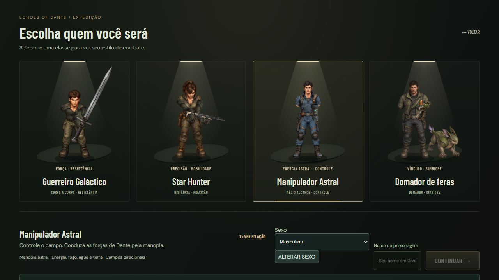
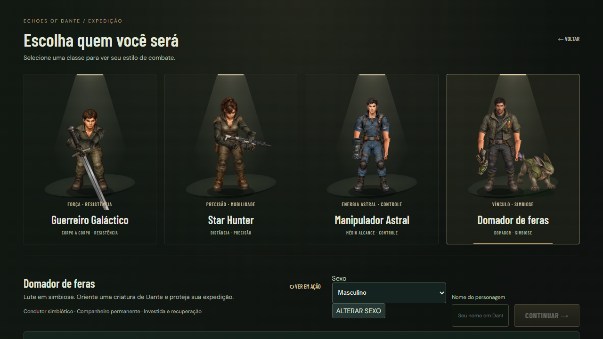

# Etapa 1 — personagens completos e início imediato

**Correção vigente: [0.1.103 — início direto e cotovelos](revision-03/README.md).** O usuário não aprovou os braços da 0.1.102 e encontrou retorno indevido ao menu. Os resultados abaixo são evidências técnicas anteriores, não aprovação visual.

Versão de entrega: **0.1.102**. Parte do [plano aprovado](../DANTE_COLONIZATION_PLAN.md). **Avaliação humana pendente.** Esta entrega não implementa chat, cinemática nova, missões ou regiões.

## Como testar sem alterar seus personagens

- [Seletor e início da jornada](https://echosofdante.vercel.app/campaign-playtest.html?v=0.1.102): selecione classe, apresentação e nome; continue e clique na dificuldade. No cooperativo, escolha antes o tamanho da equipe. O clique inicia a abertura existente e depois o jogo/lobby, sem confirmação adicional.
- [Corpo, movimento e peças](https://echosofdante.vercel.app/character-cohesion.html?class=astral&sex=male&kit=clothes&v=0.1.102): o painel abre recolhido; permite quatro classes, duas apresentações, três conjuntos, combinações de peças e três armas. Caminhe, mire em volta, ataque e segure/solte Q. Trocas são somente visuais neste laboratório.
- [Biblioteca reservada](https://echosofdante.vercel.app/test-library.html).

O laboratório de campanhas usa armazenamento temporário da aba; o de corpos usa a cena isolada sem salvar jornada. Personagens e saves do jogo principal são preservados. As correções também se aplicam ao jogo principal e à mesma classe de representação dos aliados cooperativos.

## Diagnóstico e alterações

1. **Seletor:** na 0.1.101, Astral/Domador não desenhavam os braços articulados. A alegação de que os corpos já tinham braços completos era incorreta: as pinturas terminam em mangas/cortes de encaixe. Agora os retratos montam braços, punhos e instrumentos com a mesma referência corporal e matemática do jogo.
2. **Guerreiro/Hunter:** pivôs eram definidos pelos centros dos recortes, com largura/altura independentes. Os eixos reais das pinturas passam a definir ombro–cotovelo–punho e escala uniforme de braços/mãos. Cotovelos dobram para baixo/fora nas poses de pegada, em vez de cruzar a parte alta do peito/pescoço.
3. **Equipamento:** ombros registrados para cada apresentação, pose e nível de torso, incluindo combinações de peças. Não vestir armadura sobre outro corpo; continuar usando a composição de faixas existente, atualizada somente na troca de roupa.
4. **Movimento/coop:** Hunter acumula o deslocamento assinado para evitar saltos na fase da passada ao inverter direção. Guerreiro remoto passa a reproduzir o mesmo alcance visual das mãos durante ataque/carga usado no jogador local.
5. **Novo jogo:** clicar na dificuldade cria/inicia uma única campanha. Tamanho da equipe numa tela anterior. Nome, classe e apresentação ficam em rascunho em memória ao voltar ou abrir configurações. Não há descrição adicional nas opções de dificuldade.

## Referências compartilhadas

- `HumanPose.ts`: projeção do encaixe, solução da pegada, transformação proporcional da pintura, alcance visual do Guerreiro.
- `CasterPose.ts` e `HunterRiflePose.ts`: poses/instrumentos já existentes, reutilizados pelo seletor.
- `character-shoulder-registration.json`: ombros por quadro/roupa/apresentação, calculados offline de pixels opacos.
- `character-arm-registration.json` / `caster-arm-registration.json`: pivôs no próprio desenho. A geração de metadados não altera as pinturas.
- `scripts/prepare-shoulder-sockets.py`: regeneração offline reproduzível. Não examinar alpha nem gerar assets durante gameplay.

**Assets reutilizados:** corpos `wardrobe-*`, conjuntos `*-arm-*`/`*-arm-kit`, armas iniciais/atuais/avançadas e companheiro existentes. **Nenhum novo raster, textura de cenário ou equipamento.** Combate, estatísticas, controles, colisões, progressão e mapas preservados.

## Comparação visual

### Antes — 0.1.101 rejeitada

### Depois — montagem articulada

[Todas as apresentações masculinas](qa/menu/selection-male.png) · [Todas as apresentações femininas](qa/menu/selection-female.png).

[Poses capturadas no jogo](qa/after/) incluem frente, costas, perfil e Q nas oito apresentações. As capturas são uma revisão assistida, não aprovação visual do jogador.

## Validação

Evidências técnicas e medições são registradas em `qa/`. Executar a matriz com `node scripts/qa-character-cohesion.mjs`, além de typecheck/build e QA de campanha/coop aplicável. Os testes de encaixe conferem pixels reais opacos no corpo e nos ossos; compilar sozinho não prova continuidade visual.

O teste do início cobre clique repetido, digitação A/L, rascunho ao voltar/configurar, nomes exatos de dificuldade, tamanho da equipe antes da dificuldade e entrada no lobby real local. O teste visual cobre quatro classes, duas apresentações, três armas, quatro conjuntos incluindo peças misturadas, oito direções e ações/passadas.

### Resultados técnicos desta entrega

- `npm run typecheck` e `npm run build`: passam. Aviso já existente sobre tamanho do bundle Phaser, sem erro de compilação.
- [Matriz de personagens e início](qa/report.json): **6.912 poses** verificadas, pixels opacos nas junções, escala uniforme de membros/mãos, sem erro JS/carregamento. Testes de menu por teclado e touch nas quatro resoluções.
- [Espelhos e estabilidade](qa/stability/report.json): **1.024 comparações** local/`PartyActor`, sem diferença nas transformações medidas. Três ciclos de morte/reinício por classe, sem crescimento de contagens de objetos, texturas, tweens ou listeners do input; um único controle touch.
- FPS da Floresta, uma página Chrome, amostras controladas sem combate: Guerreiro **59,98**, Hunter **60,17**, Astral **59,85**, Domador **59,99** updates/s. Não são medições de mobile físico nem da campanha completa com quatro clientes.
- [Build compilado e equipe](qa/compiled/report.json): convites, formação/início com quatro classes, movimento/básico/Dash/Q de cada participante confirmados em snapshots reais, saída do anfitrião, touch e navegação gamepad. Sem exportações de DEV.
- [Seletor compilado](qa/menu/report.json): as oito apresentações e suas demonstrações manuais finitas. [Controles em gameplay](qa/controls/report.json): joystick, básico, Dash e segurar/soltar Q por touch/CDP; movimento/ataque/Dash/Q por Gamepad API mock. Sem alterar os controles.
- A execução longa anterior de `qa-party-four.mjs` [interrompeu por timeout](qa/party/report.json) após um visitante desconectar durante a verificação de Q. Não houve erro JS/asset nessa execução; a causa não foi determinada. Não declarar a campanha cooperativa longa inteira aprovada a partir dos testes focados desta entrega.

Os relatórios compilados/matriz de retratos e eventual verificação pública são as evidências atuais; o conteúdo histórico da 0.1.101 não aprova a revisão visual nova.

## Limitações e gate

- Exige playtest humano caminhando/lutando e avaliação dos retratos, especialmente articulações e pegadas em diagonais com peças misturadas.
- Touch e gamepad são emulados quando indicados nos relatórios. Não houve teste físico em iPhone/controle nesta entrega.
- Os rigs continuam sendo pinturas articuladas, sem animação esquelética ou novos quadros de corpo. A correção preserva os pés/pinturas atuais.
- **A abertura legada da 0.1.101 permanece provisória.** Não foi transformada em filme de atuação nesta etapa. O piloto animado de 12 segundos só será produzido na etapa 3, depois da comunicação e da respectiva validação.
- Após aprovar esta entrega, a próxima é **nomes e chat cooperativo**; missões e colonização continuam planejadas.
