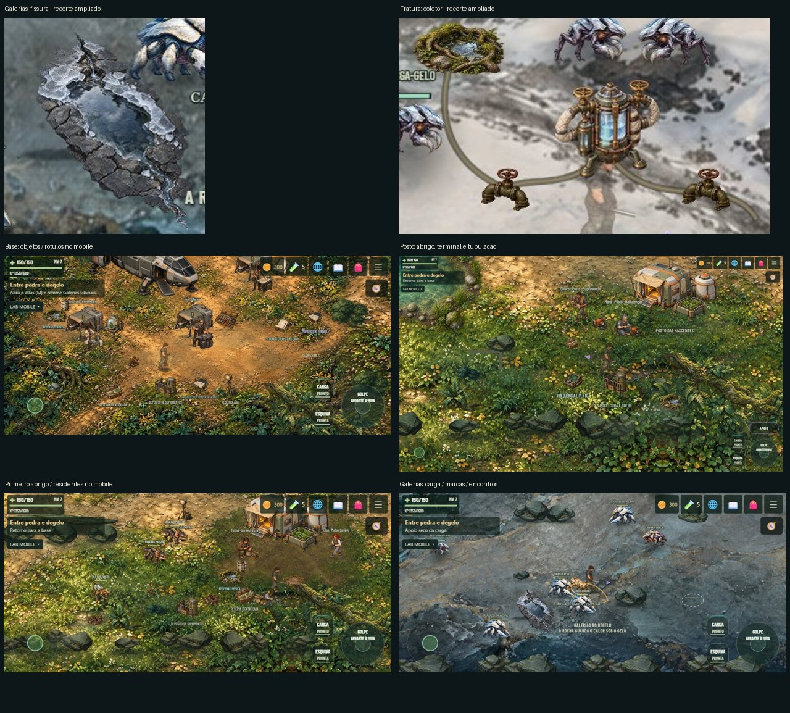
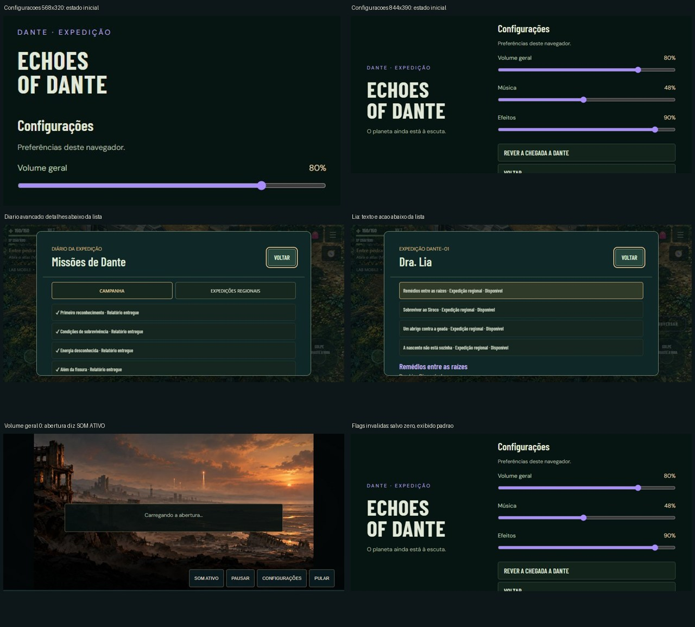

# Auditoria de front-end, UX e integração visual · 0.1.178

**Data:** 01/11/2026. **Base auditada:** aplicação `012ebb9`, documentação `a81b26b`. **Solicitação:** auditar a última implementação, incluindo se os objetos adicionados pertencem visualmente ao terreno ou parecem colados sobre ele.

## Parecer

A 0.1.178 melhorou a confirmação dos sliders e passou a controlar a trilha por Web Audio, mas **não deve ser considerada encerrada como correção completa do áudio**. Há um defeito reproduzido na campanha pública: começar com volume zero e depois restaurá-lo pode deixar a música permanentemente muda naquela voz. O ganho sobe, mas o elemento continua `muted` e o sinal permanece zero.

A integração dos objetos é **parcial**. As silhuetas próprias resolveram boa parte da repetição de maletas/prismas. Abrigos e oficinas têm relação mais convincente com o espaço. Fissura, coletor na neve, pequenos equipamentos sobre vegetação e algumas tubulações ainda apresentam diferenças perceptíveis de borda, nitidez, perspectiva ou apoio no chão. Isso exige acabamento localizado dos objetos, preservando os terrenos aprovados.

Há também fricção no mobile: Configurações exige rolagem em telas baixas; listas de relatórios ocupam a primeira tela do diário e das conversas; nomes de objetos competem entre si. Funcionar por rolagem não resolve a hierarquia da informação.

**Esta entrega é uma auditoria. Nenhuma correção de gameplay, áudio ou arte foi aplicada, nem novo capítulo iniciado.** A avaliação visual abaixo é do agente; aprovação humana continua separada.

## Evidência visual rápida

As pranchas apenas recortam/redimensionam capturas. Não alteram cor, sombra ou textura dos objetos. Os arquivos de tela inteira estão junto dos recortes.

## Escopo e método

- Navegação no cliente **publicado**, sem globais DEV: Configurações, criação feminina, abertura, armazenamento e reprodução do defeito de volume por inputs normais.
- Sete tamanhos em CSS pixels: 568×320, 844×390, 852×393, 915×412, 393×852, 1024×768 e 1920×1080. Chrome instalado, toque emulado. Não é Safari/iOS físico.
- Inspeção local da mesma fonte da 0.1.178 em **sete mapas**: base, Nascentes, Terraços, Siroco, Dunas, Fratura e Galerias; doze enquadramentos do mundo, além de diário, atlas, mochila e conversa com Lia. Capturas desktop/mobile e dados de objetos/obstáculos em [report.json](evidence/report.json).
- Revisão do renderer compartilhado de **36 tipos de quest prop**, dos dois atlas de 16 quadros e dos objetos independentes; sete tipos de survey prop. A revisão em contexto usa amostras representativas e não afirma ter testado todas as combinações possíveis de objeto, missão e mapa.
- Fixtures explícitas: cópia isolada do checkpoint de QA das Galerias para observar a campanha avançada; viagens/posições e invulnerabilidade apenas para enquadramento. Os capítulos anteriores já estão considerados concluídos nessa cópia. Vésper/Incandescente não são derrotados pela auditoria. Herói semitransparente em algumas capturas resulta da invulnerabilidade de cobertura e não é registrado como defeito visual do jogo.
- Dados reais: perfis Chrome novos e laboratórios com namespace temporário; sentinelas de personagens/settings reais preservadas nos ensaios públicos. O caso de sessão corrompida injeta um dado inválido deliberadamente e está identificado como teste de resiliência.
- Não mediu FPS, RAM, bateria, latência humana ou dificuldade. Não repetiu a campanha cooperativa inteira; o protocolo/health e a evidência de publicação são conferidos separadamente. Não substitui teste em iPhone, leitor de tela ou equipe humana.
- Limitação do laboratório novo de áudio: em [main.ts](../../src/main.ts), somente `mobile-review` é excluído do carregamento imediato do mundo em `menuLab`; `audio-review` inicializa a cena atrás do menu e, portanto, não representa o mesmo perfil de carregamento da entrada oficial. Rever essa equivalência antes de usar o laboratório para concluir algo sobre memória/inicialização no iPhone. A reprodução pública A01 usa `mobile-review` e não depende dessa diferença.

## Problemas por prioridade

**P1:** defeito funcional com reprodução direta. **P2:** lacuna relevante de comportamento, leitura ou coerência visual. **P3:** melhoria de consistência. Confiança distingue medição/reprodução de avaliação visual e risco ainda não reproduzido no aparelho.

### A01 · P1 · A música não volta depois de iniciar com volume zero

**Reproduzido no site público.** Configurações → Geral 0 → criar campanha → pular abertura → iniciar áudio → Configurações → Geral 80/Música 48/Efeitos 90 → retomar. A música permanece muda.

Resultado: contexto `running`, mídia tocando, ganho `0.2111999989`, **`muted:true`, pico de saída `0`**. O caso normal local produziu pico `0.03984`; os casos liberados com volume/foco zero produziram pico zero, embora o ganho estivesse positivo. [Fluxo público completo](evidence/audio-public-zero.json), [níveis restaurados na interface](evidence/audio-public-restored.jpg), [casos locais](evidence/report.json).

**Causa:** [Sound.ts](../../src/systems/Sound.ts), `applyMusicVolume` põe `media.muted=true` no caminho nativo; `routeMusic` muda para Web Audio; o caminho roteado restaura volume/ganho, mas não limpa esse mute anterior.

**Correção recomendada:** definir uma única autoridade de mute/ganho e normalizar a mídia na migração para Web Audio. Preservar o silêncio pedido pelo usuário através do ganho, sem carregar um mute residual.

**Aceite:** iniciar salvo em zero, restaurar Geral/Música, retomar, viajar e recarregar; medir sinal depois do ganho e verificar `muted`, além dos valores dos sliders. O QA anterior verificava ganhos positivos e, por isso, não cobria esse defeito. Confiança alta.

### A02 · P2 · A abertura ficou fora da correção e mostra estado de som incoerente

[Prologue.ts](../../src/ui/Prologue.ts), `volumes`, continua alterando apenas `video.volume`. Não utiliza a nova rota da trilha; `_sfx` não participa, pois o filme já tem uma mixagem única. Com Geral 0, a captura pública registra **`volume:0`, `muted:false`, botão “SOM ATIVO”**. [Captura](evidence/prologue-master-zero.jpg), [dados](evidence/report.json).

No Chrome desktop o volume zero silencia o vídeo, apesar do texto incorreto. **Não foi comprovado aqui se o iPhone ignora esse setter**; permanece justamente o caminho que a última entrega procurou evitar na música. Não afirmar que a abertura já está corrigida no aparelho.

**Correção recomendada:** incluir a abertura na política de volume/mute e fazer o botão refletir o silêncio efetivo. Explicar que as vozes/efeitos do filme são uma faixa já mixada, se essa separação continuar no produto.

**Aceite:** Geral 0 antes/depois de abrir o filme, mute próprio, restauração, replay, retorno das configurações e reteste iOS. Confiança alta no código/estado visual; comportamento físico ainda pendente.

### A03 · P2 · Uma flag de sessão inválida faz ignorar preferências válidas de áudio

O construtor de [ApplicationShell.ts](../../src/ui/ApplicationShell.ts) lê flags transitórias e settings no mesmo `try`. Se `invite-character-once` contém JSON inválido, o parse falha antes de ler a configuração de volume.

**Fixture pública reproduzida:** salvo `{master:0,music:0,sfx:0}`, flag transitória `{broken`; interface inicia com **80/48/90**, apesar dos zeros persistidos. [Dados](evidence/details.json), [captura](evidence/settings-stale-session.jpg). É um teste de dado corrompido, não uma afirmação de que toda sessão normal falha.

**Correção recomendada:** isolar leitura/validação de cada chave; preferências válidas não devem depender de dados efêmeros de convite. Aceite: cada flag inválida ou indisponível deixa as preferências de volume válidas em vigor. Confiança alta.

### U01 · P2 · O jogador não consegue conferir a música enquanto ajusta

[GameScene.ts](../../src/scenes/GameScene.ts), `pauseForShell`, põe o foco musical em zero. Dentro de Configurações, mexer em Música mantém o produto final em zero até retomar. Não há amostra de música/efeito nem indicação de que a música está silenciada pelo menu. Isso dá pouca confirmação perceptiva para quem acabou de relatar que os controles parecem não funcionar.

**Recomendação:** permitir escuta controlada na tela ou oferecer amostra curta e explícita, com os mesmos buses e limites. Se continuar silenciosa, informar “Aplicado ao retomar” e oferecer teste de efeitos. Conferir também no convidado cooperativo. Confiança alta na causa e julgamento de UX.

### U02 · P2 · Configurações usa espaço excessivo com a marca no mobile

Em **568×320**, a área inicial mostra a marca e somente Geral; Música, Efeitos e Voltar ficam abaixo. O conteúdo tem 579 px para viewport de 320. Em **844×390**, Voltar termina em y=411; o conteúdo chega a 427 px. Não há overflow horizontal, e é possível alcançar os botões por rolagem: é problema de hierarquia/descoberta, não bloqueio total.

[568×320](evidence/settings-568-320.jpg), [844×390](evidence/settings-844-390.jpg), [medidas antes/depois de rolar](evidence/report.json).

**Recomendação:** layout compacto para configurações na horizontal, reduzindo/retirando a marca nesse estado e mantendo a saída visível. Aceite: os três controles e Voltar acessíveis no enquadramento pequeno sem rolagem desnecessária. Confiança alta.

### U03 · P2 · Diário e conversa escondem o conteúdo atual atrás de listas

Em campanha avançada, o diário abre com relatórios concluídos antes dos detalhes da missão selecionada. No mobile a lista ocupa praticamente todo o espaço útil. Na conversa com Lia, as opções de expedição regional empurram oferta, objetivos e aceite para baixo.

[Diário](evidence/journal-mobile.jpg), [Lia](evidence/lia-dialog-mobile.jpg). [MissionPanel.ts](../../src/ui/MissionPanel.ts) preserva a ordem integral das missões; [missions.css](../../src/ui/missions.css) combina lista de até 215 px com rolagem do diálogo.

**Recomendação:** destacar a missão acompanhada/disponível, recolher concluídas e separar lista de seleção do conteúdo. Aceite: abrir diário/conversa no mobile mostra o objetivo ou a oferta atual e a ação relevante sem atravessar uma lista histórica. Confiança alta nas capturas; não é falha da persistência de tracking.

### U04 · P2 · Rótulos de objetos competem entre si e com a ação

Na base avançada, depósito, reserva, energia e registro ficam muito próximos; alguns nomes se sobrepõem visualmente à vegetação e a outros nomes. Nas Galerias, carga, descoberta, título do mapa e nomes de criaturas concorrem quando o encontro ocorre junto do transporte. O tamanho em mundo perde legibilidade no mobile.

[Base mobile](evidence/base-cluster-mobile.jpg), [carga mobile](evidence/gallery-cargo-mobile.jpg), [primeiro abrigo](evidence/first-camp-mobile.jpg).

**Recomendação:** priorizar o objeto em foco e a missão acompanhada, reduzir nomes permanentes distantes e reservar o texto completo à aproximação/interação. Preservar sinais/portais. Aceite: alvo, ação e personagem são identificáveis durante encontro real sem sobreposição de rótulos relevantes. Confiança visual alta.

### U05 · P3 · Área de toque dos sliders menor que a dos demais controles

Os ranges têm **38 px** de altura; os botões do painel têm 44/50 px. Há bom comprimento horizontal e o toque emulado funciona. É uma inconsistência com os alvos maiores que o próprio jogo já usa, não uma declaração de infração a norma de acessibilidade.

**Recomendação:** aproximar a área útil dos sliders da dos demais controles, respeitando a tela baixa. Validar com dedo real e com o movimento de rolagem ao redor. Confiança alta nas medidas; conforto físico pendente.

### V01 · P2 · A fissura ainda tem aparência de recorte sobre o terreno

A substituição eliminou a vegetação verde da análise nas Galerias e melhorou a função narrativa. Porém, a borda do afloramento é mais escura/nítida que a pintura de gelo; o contorno fechado lê como uma ilhota elevada colocada sobre o chão. A ligação visual da saída com o canal não fica contínua em todos os enquadramentos. O objeto também parece mais volumoso do que um decalque raso.

[Tela inteira](evidence/gallery-cargo-desktop.jpg), [detalhe ampliado](evidence/integration-comparison.jpg). [RegionalExpeditions.ts](../../src/systems/RegionalExpeditions.ts) aplica o PNG em 190×215 e desenha o escoamento separadamente. O recorte transparente por si só não integra o material ao terreno.

**Recomendação:** acabamento de transição no perímetro, gelo/rocha com valores próximos do chão aprovado e saída conectada visualmente; tornar inequívoca a pouca altura. Revalidar arte/física após esse ajuste. Não foi detectado por este ensaio um novo bloqueio do caminho, e não se recomenda mexer no enquadramento `groundY:-300 / groundHeight:2300`.

**Aceite visual:** observar de ambos os lados, com personagem ao lado e no mobile; bordas, profundidade e escoamento devem pertencer à mesma formação. Avaliação do agente; aprovação humana pendente.

### V02 · P2 · Coletor e válvulas não se assentam convincentemente na neve

Equipamento tem contorno/metal muito definido, enquanto o piso é mais suave. Falta resposta local da neve no apoio: compressão, pequena abertura de solo ou contato que acompanhe as bases. As mangueiras parecem traços uniformes sobre a imagem em vez de objetos apoiados. A nascente usa o survey de raízes, que também contrasta com o gelo; a origem morna contextualiza a água, mas não resolve sozinha a transição material.

[Coletor](evidence/cold-collector-desktop.jpg), [detalhe](evidence/integration-comparison.jpg). [FrostWater.ts](../../src/visual/FrostWater.ts) desenha mangueiras por strokes e adiciona equipamento com [addQuestProp](../../src/visual/QuestProps.ts), sem um acabamento específico de assentamento na neve.

**Recomendação:** bases com contato coerente, pequenas marcas de instalação/neve e mangueiras com volume discreto, juntas e sombra de contato. Não aumentar o equipamento para torná-lo legível. Aceite visual: não parecer suspenso e manter claros os dois registros e o recipiente. Avaliação do agente.

### V03 · P2 · Objetos de solo e mobiliário usam integração uniforme entre biomas

O renderer genérico usa o mesmo PNG, origem e tamanho quadrado; itens colocados em vegetação alta mantêm a borda completa e nítida. No posto, terminal e depósito parecem pousados em folhas; nas reservas próximas dos abrigos falta uma faixa de uso que explique onde os colonos caminham/trabalham. A sombra embutida no asset ajuda, mas não substitui a relação com o material local.

[Posto](evidence/post-building-desktop.jpg), [base](evidence/base-cluster-mobile.jpg), [acampamento](evidence/first-camp-mobile.jpg). [QuestProps.ts](../../src/visual/QuestProps.ts), [PermanenceWorld.ts](../../src/systems/PermanenceWorld.ts).

**Recomendação:** pequena base de terra usada/vegetação deslocada para o mobiliário fixo, sombra curta compatível com a luz, variação discreta de sujeira/neve/areia e oclusão controlada por folhas na borda. Diferenciar equipamento temporário de instalação permanente. Bake/cache dos detalhes estáticos; não criar pintura pesada por frame nem mudar os terrenos inteiros.

**Aceite visual:** comparar silhueta e apoio com o abrigo aprovado; itens continuam reconhecíveis sem depender de uma borda artificialmente contrastada. Avaliação do agente.

### V04 · P2 · Tubulação das Nascentes parece desenho de interface no chão

O retorno de água aparece como um **L cinza de espessura uniforme**, com cantos retos e sem material/juntas. Ele se destaca como marca gráfica sobre a pintura orgânica. [Captura](evidence/post-building-desktop.jpg), canto esquerdo ao centro. [PermanenceWorld.ts](../../src/systems/PermanenceWorld.ts), objeto `water-return-pipe`, usa `lineStyle(10, ...)`.

**Recomendação:** manter o percurso funcional e aplicar segmentos/juntas com volume/sombra, parcialmente assentados no solo. Rasterizar uma vez. Distinguir visualmente essa tubulação física das marcações intencionais de encaixe de carga, que podem continuar sendo sinais gráficos. Aceite: ler como infraestrutura do acampamento, mantendo fluxo e função reconhecíveis. Avaliação do agente.

### V05 · P2 · Preservar os objetos quando encobrem o herói

**Adendo solicitado pelo usuário em 01/11:** remover a transparência automática dos objetos na aproximação/sobreposição com o herói. Preservar a aparência do objeto, permitindo que ele encubra o personagem conforme sua profundidade. O usuário relata preferência contrária ao efeito atual na avaliação da esposa e ainda tem dúvida pessoal; isso define a mudança desejada, sem registrar aprovação antecipada do resultado.

**Confirmado por revisão de código:** [EnvironmentArt.ts](../../src/visual/EnvironmentArt.ts), `updateEnvironmentOcclusion`, reduz a opacidade dos objetos registrados a **28% da opacidade original** quando detecta que cobrem o herói. Existe também uma redução por proximidade nas copas em [CampaignEnvironment.ts](../../src/visual/CampaignEnvironment.ts), até **40% da opacidade original**. Não significa que todo objeto do jogo participa desses sistemas. Este adendo não acrescenta reprodução visual ou capturas às evidências anteriores.

**Alteração prevista:** retirar a redução de opacidade motivada por proximidade/ocultação do personagem nos objetos ambientais, incluindo as copas abrangidas por esse comportamento. Manter opacidade própria do material, animações ambientais e efeitos intencionais de abertura/desaparecimento; não forçar opacidade total em partículas, água ou outros materiais translúcidos. Manter ordenação de profundidade e colisões coerentes, sem elevar artificialmente o herói acima dos objetos.

**Aceite:** aproximar, passar atrás, sair e retornar nos dois sentidos; o objeto mantém sua aparência e pode encobrir o herói. Conferir abordagem e interação nos pontos de missão, navegação junto de paredes/portais e leitura do combate, inclusive no convidado e no mobile. Corrigir posicionamento/colisão quando necessário para permitir interação legível, sem reintroduzir a transparência automática nem liberar passagem por sólidos. Avaliação visual humana pendente. **Item registrado para correção; comportamento ainda não alterado nesta auditoria.**

## O que se sustenta na amostra

- Percentuais acompanham os três sliders; áreas de input são semanticamente nomeadas; não houve overflow horizontal nas sete larguras.
- No caminho normal já desbloqueado, a música passa pelo ganho correto; os buses de Música e Efeitos são distintos. O problema A01 é um estado de inicialização não coberto anteriormente.
- Silhuetas dos atlas agora diferenciam sondagem, arquivo, válvula, receptor, reserva e acessórios. O problema restante é integração com o ambiente e hierarquia de interação, não falta de identidade em todos os itens.
- Abrigos/oficina possuem volume, luz e relação espacial mais consistentes que os pequenos props. Não há motivo neste audit para substituir as pinturas de terreno aprovadas.
- HUD compacto e controles móveis continuam utilizáveis nos enquadramentos observados; saída do diário/mochila fica no cabeçalho. Isso não aprova integralmente todos os estados de interface.
- Nenhum erro JavaScript não tratado nos roteiros concluídos. Sentinelas reais dos testes públicos ficaram intactas. A faixa cinza lateral anterior não reapareceu nas capturas da base dessa amostra.

## Ordem recomendada de correção e critérios de encerramento

1. **Áudio:** A01, A02, A03. Medir saída real após mute/unmute, carregar preferências de forma independente e retestar no iPhone. Uma barra de ganho positiva não basta como prova de som.
2. **UX mobile:** U01–U05. Configurações compactas com confirmação audível, diário/conversas centrados na tarefa e rótulos com prioridade. Conferir pausa, convidado, reload, teclado, touch e gamepad.
3. **Piloto de integração visual:** fissura + coletor, para calibrar borda, detalhe, sombra e assentamento mantendo R3/referência D. Incluir V05: preservar objetos sem transparência automática ao encobrir o herói, verificando profundidade, colisões e interação. Depois aplicar o mesmo critério aos pequenos objetos da base/posto e às tubulações. Avaliar dentro da campanha, não só em fundo transparente.
4. **Gate humano:** iPhones 13/13 Pro; escuta e percepção de integração. Só depois retomar o capítulo seguinte. Esta auditoria não inicia esse trabalho nem registra aprovação antecipada.

## Reprodução e verificação da auditoria

Roteiros: [levantamento/áudio local/cenas](../../scripts/audit-frontend-178.mjs), [reprodução pública de mute](../../scripts/audit-audio-muted-178.mjs), [resiliência e detalhes](../../scripts/audit-ux-details-178.mjs), [pranchas](../../scripts/audit-contact-sheets-178.py).

Com Vite local em 5185: `node scripts/audit-frontend-178.mjs`. Os outros dois roteiros usam a Vercel por padrão e o segundo usa também a cópia local para enquadrar o mundo. Relatórios: [levantamento](evidence/report.json), [mute público](evidence/audio-public-zero.json), [detalhes/resiliência](evidence/details.json). As falhas intermediárias de roteiro foram corrigidas; não são contadas como defeitos do produto.

- [x] Revisão de código e capturas, casos de áudio com sinal medido, layouts e relato de limitações.
- [x] `node --check` nos roteiros, JSONs válidos, links locais, montagem das pranchas e `git diff --check`.
- [x] `npm run typecheck` e `npm run build` em 01/11; 270 módulos, aviso existente de chunks grandes. Build passar não invalida os defeitos de UX/áudio reproduzidos.
- [x] Auditoria `20cc941` enviada a `origin/main`, igualdade local/remota conferida e entrada da biblioteca pública verificada em 01/11. [Registro da publicação](evidence/publication.json). Versão de aplicação mantida em 0.1.178; alterações desta entrega são auditoria/documentação/roteiros.
- [ ] Correções dos problemas encontrados (fora do escopo desta auditoria).
- [ ] Confirmação final do relay: os 73 hashes públicos da aplicação conferem, mas a consulta ao servidor cooperativo expirou. Esta auditoria não certifica disponibilidade ou compatibilidade do coop nessa consulta.
- [ ] Aprovação/reteste humano.
