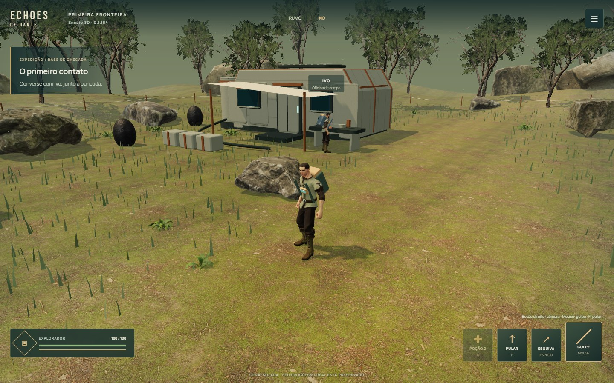

# Primeira fronteira · ensaio 3D · 0.1.184

**Revisão atual · 0.1.186:** [identidade de armas, efeitos, criaturas, NPCs e nave](IDENTITY.md), com oficina própria e circuito original preservado. Autorizada em 04/11; QA técnico e aprovação humana separados.

**Próxima avaliação autorizada · 0.1.185:** [acampamento de pouso + Floresta de Dante, criação de personagem e quatro kits iniciais](ARRIVAL.md). Entrada nova e isolada; o laboratório abaixo continua disponível. A aprovação da iluminação/vegetação anterior não se estende ao mob, ao novo editor ou à reconstrução. Playtest recebido em 04/11: natureza e figuras humanas elogiadas; equipamentos, poderes, criaturas, NPCs e estruturas aguardam [revisão de identidade](ASSET_IDENTITY_PLAN.md). Siroco aguarda essa revisão e validação.

Em 03/11/2026, depois de conhecer Keldurn e Last Havens, o usuário autorizou explicitamente a proposta de **um pequeno protótipo separado: trecho da base, personagem, NPC e inimigo** (“FAÇA ISSO PQ EU ACHO QUE ECHOES MERECE”). Essa autorização permite este experimento antes do próximo capítulo. Não declara a revisão visual 0.1.181 aprovada e não autoriza migrar toda a campanha.

[Abrir o ensaio](https://echosofdante.vercel.app/frontier-3d.html?v=0.1.184), registrado na biblioteca. Three.js 0.187.0/WebGL2 em uma entrada própria do Vite, sem carregar Phaser nem os sistemas/saves/relay da campanha. A campanha continua em Phaser, com as pinturas aprovadas. Protocolo cooperativo 16 preservado.

## Revisão visual solicitada · 0.1.184

O usuário gostou da jogabilidade, considerou os gráficos insuficientes e pediu continuar essa revisão. Trabalho restrito ao mesmo trecho solo; não autoriza migração completa ou outro capítulo.

- Explorador e Ivo adultos, com roupa, cabelo, rosto e rig completo compatível. Derivados dos arquivos Standard oficiais de Quaternius: traje inteiro de trabalho, cabeça/cabelo sobre o mesmo esqueleto e oito animações in-place. Preservados os materiais PBR; cores distintas, mochila, tiras e instrumento de campo presos ao torso. O personagem da campanha e o Ivo já aprovado não foram substituídos. O intruso continua sendo o modelo de referência anterior.
- Árvores/plantas Poly Haven CC0: troncos e galhos 3D com materiais próprios, duas vistas da árvore completa preparadas offline para as copas, quatro variantes de samambaias e rochas naturais também no perímetro. **As copas usam planos cruzados com recorte alpha, não milhões de folhas geométricas.** Funcionam como vegetação de média/distante visão; aproximações e ângulos rasantes podem revelar essa simplificação e precisam de avaliação humana. A floresta exterior é cenário, não mapas adicionais.
- Abrigo com casco chanfrado, nervuras, painéis, janelas e ferragens; pintura com desgaste preparada uma vez, iluminação indireta sobre os materiais e paleta menos saturada no solo. Rochas periféricas parcialmente enterradas; plantas fora das aproximações de missão. Câmara inicial mais próxima e baixa; órbita/zoom continuam livres. Portas fechadas, bancada, toldo e degrau mantêm o volume físico do ensaio.
- Preparação offline e fontes em [asset-tools](../../scripts/asset-tools/README.md), [pesquisa](ASSET_RESEARCH.md) e [manifesto](../../public/assets/frontier-3d/visual184.json). Sem biblioteca de preparação no bundle do jogo, chamadas a API ou renderização neural no navegador. Arquivos humanos aproximadamente 1,3 MB cada. Objetos estáticos continuam reunidos por material; equipamento também é reunido por material antes de prender ao osso.
- Mesmas teclas, salto/gravidade, combate, circuito, interface e sessão temporária. Os clipes humanos novos já são in-place; a compensação de altura do antigo explorador fica restrita ao modelo antigo. **Pré-requisitos simulados: nenhum.** QA de morte/armazenamento bloqueado usa fixtures explícitas apenas da sessão deste ensaio.

**QA técnico local:** typecheck/build (291 módulos), circuito completo no compilado, combate/poção/esquiva, entrega/reload/reinício, colisões, salto sob o toldo e retorno ao degrau passaram. Toque/gamepad emulados, sete resoluções, interação em telas pequenas, morte/retorno, JSON inválido, armazenamento bloqueado, falhas de GLB/copa e perda deliberada do contexto gráfico passaram. Verificação dos dois rigs amostrou 976 poses: geometria íntegra, rosto/cabelo acompanhando o corpo caído e sem segundo voo vertical na animação. Capturas de chegada, conversa, combate, toldo, pouso e toque inspecionadas pelo agente. Relatórios em `qa/0.1.184/`; a primeira execução DEV foi interrompida por HMR durante uma edição, não é tratada como aprovação e foi substituída pela bateria do compilado.

O primeiro roteiro público presumiu somente um golpe durante a aproximação e encontrou vida 46 em vez de 73. A [observação foi preservada](qa/0.1.184/observations/public-first-run.json). O roteiro agora acompanha passivamente cada dano e observa o estado antes/depois do evento nativo H, verificando 27 por golpe e cura/carga da poção no próprio comando. Compilado e público passaram novamente; nenhum dano, cura, tempo, collider ou estado do jogo foi alterado para satisfazer o teste.

**Desempenho medido:** Intel UHD, Chrome headless, 1440×900/DPR 1, cena estacionária: aproximadamente 35–38 FPS em Equilibrada e 36–41 em Mais leve. Contadores em torno de 350 mil triângulos com os passes de sombra, 87–90 chamadas e 58–60 texturas, conforme a cena. É uma revisão visual mais custosa que a referência anterior; não promete 60 FPS, desempenho idêntico à campanha ou resultado em iPhone. [Amostras por qualidade/dispositivo](qa/0.1.184/compiled-visual/report.json). A opção leve elimina as sombras, mas não troca os modelos.

**Publicação confirmada:** aplicação `9ba98fe` em `origin/main`, Vercel success e 35 hashes conferidos. Circuito público completo e salto/entradas públicos passaram. [Registro e limitações](qa/0.1.184/publication.json). Evidências/documentação seguem em commit separado, sem diferença nos arquivos da aplicação já publicada. **Aprovação estética e testes em iPhone físico permanecem pendentes.** Emulação de toque/gamepad e inspeção de capturas pelo agente não são aprovação humana.

## Revisão solicitada pelo playtest · 0.1.183

O usuário achou o ensaio interessante e pediu comandos familiares, salto e pesquisa de repositórios para melhorar as imagens. Essa avaliação autoriza a revisão do ensaio; não aprova personagens definitivos ou migração da campanha.

- Teclas da campanha restauradas: mouse esquerdo ataca (inclusive segurando), Espaço esquiva, H usa poção, E interage; RB esquiva no gamepad. Salto adicional em F, X no controle e botão de toque próprio. Botão direito/arrasto touch gira a câmera; mirar com o mouse não gira a câmera. O analógico direito continua controlando a câmera 3D, uma diferença explícita em relação à mira 2D.
- A esquiva lê a direção pressionada no instante do comando, inclusive ao virar e esquivar no mesmo quadro. Salto com impulso, gravidade, arco de aproximadamente 1,15 m/0,70 s e animação do modelo. Permite deslocamento horizontal; não dá invulnerabilidade nem salto duplo. Combate/esquiva/interação aguardam o pouso. Pausa congela o salto; reload/morte/respawn retornam ao piso. A câmera acompanha a superfície horizontal para não sacudir verticalmente a cada salto. A elevação embutida no clipe original é compensada por uma curva pré-calculada, mantendo a pose completa e a física como única altura de voo, sem varrer vértices por quadro. A altura também respeita o toldo inclinado do abrigo, interrompendo o impulso ao tocar o teto. Rochas/paredes e cerca continuam sólidas: não é um sistema de escalada ou plataformas.
- Quatro rochas de aproximação recebem geometria natural e materiais 1K da Poly Haven, assentados no solo e encaixados nos raios de colisão existentes. Um lote estático, texturas compartilhadas e sem API externa no jogo. O degrau baixo do habitat agora sustenta os pés em sua altura real (0,24 m). Demais modelos/vegetação continuam sendo referência, sem alegar renovação completa do cenário.
- [Pesquisa dos repositórios, licenças e recomendação](ASSET_RESEARCH.md). [Fontes e hashes das rochas](../../public/assets/frontier-3d/scenery.json). Os personagens adultos candidatos não foram importados nesta revisão.

**QA e publicação desta revisão:** evidências próprias em `qa/0.1.183/`, sem substituir relatórios históricos da 0.1.182. Aceite estético e teste em iPhone físico continuam humanos. O circuito segue solo e isolado, sem pré-requisito/boss simulado ou alteração dos saves reais.

## O que está sendo avaliado

- Câmera de perspectiva que acompanha o explorador, órbita por arrasto e zoom, tratamento de obstrução por geometria sem tornar objetos transparentes. Geometria com volume, luz direcional/sombras, névoa, céu e materiais PBR.
- Clareira de chegada: habitat de metal/âmbar, toldo, reservatório/mangueira, bancada de Ivo, painéis solares e baliza. Rochas, raízes, plantas e perímetro de pesquisa com estacas/cabo. Caminhada bloqueada nos corpos sólidos; tubos baixos são transitáveis.
- Três modelos completos com rig e animações: explorador, técnico representando Ivo e criatura de referência. Caminhada/corrida, interação, golpe, rolamento e reação. Modelos CC0 de Quaternius, com paleta adaptada no runtime; **não são personagens definitivos de Dante nem aprovação de uma direção cartoon**. Cenário autoral usa a família de cores mineral/vegetação/metal gasto de Organic Sci-Fi R3 como ponto de partida. Não substitui arte aprovada.
- Um circuito curto: conversar com Ivo → afastar o intruso → examinar a baliza → retornar à bancada. Inimigo finito, cone de preparação com direção comprometida, investida e recuperação. Golpe, esquiva direcional com invulnerabilidade curta, duas poções e efeito visual de uso; morte/retorno preserva conquistas do ensaio. Não acrescenta HP, quotas ou esperas à campanha.
- Mouse/teclado, toque e gamepad padrão. Interface compacta, pausa, qualidade leve/equilibrada/detalhes, som breve opcional (desligado inicialmente) e sugestão de orientação dispensável no retrato. Não há nova trilha contínua neste experimento.

**Isolamento:** somente `sessionStorage['dante.frontier3d.v1']`, validação de entrada e fallback em memória se armazenamento falhar. Sem leitura/escrita dos personagens, preferências, missões, mapa, créditos ou recibos reais. Reload guarda a pesquisa, vida, poções e criatura derrotada, retornando à clareira; posição/câmera não são checkpoint da campanha. Reiniciar afeta somente este ensaio. Fechar a aba encerra a cópia temporária.

**Pré-requisitos simulados: nenhum.** É uma cena autônoma e começa do zero, não uma chegada avançada da campanha. Nenhum boss, região liberada, vitória, recompensa ou progressão real é criado. O explorador de referência é único; as quatro classes e duas apresentações da campanha não foram migradas. **Ensaio solo**, sem lobby/co-op novo. Não testa transporte da campanha ou duração da aventura. A referência ao Ivo é um papel de interação, sem substituir seu modelo/animação aprovada na base real.

## Controles

| Entrada | Movimento/câmera | Ações |
|---|---|---|
| Teclado/mouse | WASD/setas; arraste com botão direito para olhar; roda aproxima | Segurar mouse esquerdo: golpe; Espaço: esquiva (Shift também aceito); F: pular; E: interação; H: poção; Esc: pausa |
| Toque | Joystick esquerdo; arraste a área livre para olhar; dois dedos aproximam | Botões de golpe (segurar), salto, esquiva, poção e interação contextual |
| Gamepad padrão | Esquerdo: movimento; direito: câmera | RT: golpe; RB: esquiva; X: pular; A: interação; Y: poção; Menu: pausa. D-pad/A navegam opções, B retorna |

## Implementação e orçamento

Geometrias estáticas são unidas por material na inicialização; grama e folhas usam instâncias. Vento na GPU; nenhuma rasterização/desenho de cenário estático por frame. Texturas PBR 1024² compartilhadas, fontes e modelos servidos pelo próprio domínio. Sem CDN de execução ou fontes externas. Pixel ratio limitado, qualidade leve sem sombras e renderização reduzida durante pausa. Colisão horizontal simples com círculos/AABB e subdeslocamentos limitados; não representa física de plataforma ou navegação final do mundo 3D.

Diagnóstico `?inspect=1` é opt-in e **somente leitura**: estado temporário, câmera, objetos e contadores. Não oferece teleporte, setters ou vitória simulada. O QA pode observar posição para escolher entradas de teclado; a progressão principal percorre o ensaio por inputs reais. Medição de FPS usa tempo real entre quadros, separada do dt limitado da simulação; contadores não equivalem a RAM total.

## QA técnico da revisão · 0.1.183

- [x] `npm run typecheck` e `npm run build` (290 módulos; aviso existente de chunks grandes). [Build e isolamento](qa/0.1.183/build-verification.json): 86 arquivos publicados da campanha permanecem byte a byte iguais à base 0.1.181; sem mudança de cenas, sistemas da campanha, rede ou servidor. Protocolo 16 e catálogo existentes preservados.
- [x] [DEV](qa/0.1.183/local/report.json) e [compilado](qa/0.1.183/compiled/report.json): circuito completo, poção H, esquiva Espaço, criatura finita, entrega/reload, pausa, som, sete resoluções, toque e gamepad emulados. Compilado inclui aproximação por salto contra a rocha e habitat sem atravessar colliders.
- [x] [Salto e entradas no compilado](qa/0.1.183/compiled-jump/report.json): física a 25/30/60/120 Hz, ápice/pouso, bloqueio de salto duplo, deslocamento, pausa no ar, reload aterrado, X/RB, ataque repetido segurando mouse/toque e interrupção ao soltar. Botões ≥44 px sem interseção em horizontal estreito, iPhone emulado e retrato. [Contexto junto de Ivo](qa/0.1.183/context/report.json), sem sobreposição do novo botão.
- [x] [Resiliência compilada](qa/0.1.183/resilience/report.json): morte/respawn, JSON inválido, armazenamento bloqueado, downloads do personagem e das rochas interrompidos separadamente, perda deliberada de contexto/reload. Somente origem própria, incluindo blobs das texturas incorporadas no GLB; sem campanha/API/relay.
- [x] Capturas de desktop e toque inspecionadas pelo agente: silhueta/apoio das quatro rochas, herói no ar com sombra no piso e alcance dos controles. [Chegada compilada](qa/0.1.183/compiled/arrival-desktop.jpg), [salto em retrato](qa/0.1.183/compiled-jump/touch-jump-393.jpg). Inspeção do agente é QA, não aprovação artística humana.
- [x] Amostras de seis segundos: DEV aproximadamente 55–58 FPS; compilado aproximadamente 46–54 FPS, 59 chamadas/273.579 triângulos/25 texturas/33 geometrias na posição amostrada, incluindo contadores do renderizador. Não são medidas de VRAM nem benchmark de celular; há custo adicional das rochas, sem garantia de 60 FPS. Assets do ensaio totalizam 8.849.333 bytes com manifestos/créditos, sem equivalência a memória ou transferência comprimida.
- [x] Aplicação final `0425caf` após `55d0946`/`7437ea2` em `origin/main`, igualdade exata local/remoto antes do registro documental; Vercel success e [23 hashes publicados](qa/0.1.183/publication-hashes.json). [Percurso público completo](qa/0.1.183/public/report.json) e [salto/entradas públicos](qa/0.1.183/public-jump/report.json) passaram. [Registro da publicação](qa/0.1.183/publication.json). Nenhuma atualização do Render necessária.
- [ ] Playtest humano da 0.1.183: sensação dos comandos/salto, comparação visual e iPhone 13/13 Pro físico. Aguardar antes de ampliar o protótipo.

Um primeiro percurso DEV disputou foco/recursos com outro navegador de QA e recebeu um segundo golpe antes da verificação da poção. O mesmo percurso passou executado isoladamente, incluindo o compilado, sem modificar dano, cura ou requisitos para satisfazer o teste. As suítes de navegador são executadas em sequência nesta revisão. O verificador de origem também passou a reconhecer corretamente URLs `blob:` da própria origem, usadas para decodificar as imagens incorporadas no GLB, mantendo a rejeição de origens externas. O primeiro disparo do teste de contexto também apontou para preview ainda desligado; a execução na porta DEV correta passou.

O reteste final encontrou também a direção antiga da esquiva quando movimento e Espaço eram pressionados no mesmo quadro; foi corrigida para ler a entrada atual. A inspeção da geometria animada revelou que o clipe Jump já elevava os pés em quase um metro, somando uma segunda trajetória à física. `scripts/prepare-frontier-jump.mjs` gera a curva de compensação a partir do GLB original com hash registrado; o QA mede 62 poses da malha completa e limita a deriva dos pés a 2,5 cm. Nova captura do salto sob o toldo e retorno ao degrau: [compilado](qa/0.1.183/compiled-jump/awning-clearance.jpg). Nenhuma alteração no binário original ou no rig, sem montagem por membros.

A confirmação pública de pulo duplo observa o estado somente de leitura antes/depois do segundo evento nativo de teclado, no mesmo evento. Isso substitui a comparação estrita entre leituras assíncronas que podiam cair no mesmo quadro e falhar sem reinício da velocidade. O registro público preserva as duas amostras idênticas com o personagem no ar; não há setter ou teleporte.

## Histórico do QA e publicação · 0.1.182

- [x] Typecheck/build: 288 módulos, aviso de chunks grandes (Phaser existente e novo bundle 3D separado). Diff revisado. Modelos, fontes e seis texturas totalizam aproximadamente 6,9 MB com manifestos/licenças; não é RAM/VRAM total nem transferência HTTP comprimida.
- [x] Circuito completo com teclado, aviso/dano/esquiva/poção, rocha/habitat, reload/criatura finita, pausa/qualidade/som, mouse, toque emulado e gamepad mock. [Roteiro](../../scripts/qa-frontier-3d.mjs), [DEV](qa/local/report.json), [compilado](qa/compiled/report.json). Compilado também confere câmera por gesto de toque e reinício explícito sem afetar saves reais.
- [x] Layouts 568×320, 844×390, 852×393, 915×412, 393×852, 1024×768 e 1920×1080; capturas inspecionadas pelo agente. Opções rolam dentro do diálogo, botões ≥44 px, sem overflow horizontal. Amostras de seis segundos em desktop: aproximadamente 59–60 FPS; 50–57 chamadas de desenho nas posições amostradas. Não é benchmark de celular, duração longa ou pior caso.
- [x] Compilado: [resiliência](qa/resilience/report.json). Fixtures explícitas de morte, JSON inválido, armazenamento bloqueado, download abortado e perda deliberada de contexto; mensagem de recuperação/reload e dados reais preservados. Todos os recursos observados são do próprio domínio; não carrega Phaser, campanha, API ou relay.
- [x] [Comparação de build](qa/build-verification.json): **86 hashes de JS/CSS/arte da publicação 0.1.181 permanecem idênticos**; fonte da campanha/rede/servidor não alterada. Acesso a este experimento não depende de disponibilidade do relay. Nenhuma exigência de rede/protocolo foi acrescentada.
- [x] Vercel success, 21 hashes JS/CSS/HTML/modelos/materiais/fontes/licenças; texto estático normalizado para LF. [Publicação](qa/publication.json), [hashes](qa/publication-hashes.json), [percurso público completo](qa/public/report.json), [resiliência pública](qa/public-resilience/report.json). Revisão final de UI também passou no compilado e público: [contexto/controles](qa/public-context/report.json), [568×320](qa/public-context/context-568.jpg), [retrato](qa/public-context/context-393.jpg).
- [x] Aplicação final `84503a9` enviada para `origin/main`, publicação conferida por hashes; evidências finais seguem em commit documental, sem modificar o runtime.
- [ ] Playtest humano em computador e iPhone 13/13 Pro: câmera, sensação de movimento, combate, identidade visual, calor/estabilidade. Não afirmar FPS mobile a partir de emulação. **Aguardar antes de ampliar a cena ou iniciar migração.**

Os ensaios técnicos não equivalem a uma jornada humana nem a testes em aparelho físico. A adoção de 3D exigiria decidir produção de modelos/animações originais, classes, câmera/controles, mapas, rede, progressão e orçamento mobile em etapas posteriores.

Durante o QA, um roteiro tentava ir em linha reta através da rocha e depois esperava um diálogo fechado ficar visível; foi corrigido para contornar o obstáculo e esperar o estado oculto. O teste de analógico foi movido para uma posição livre, pois junto ao habitat a colisão correta podia impedir o deslocamento exigido. Não foram enfraquecidas colisões para fazer os roteiros passarem. Revisão visual também corrigiu o ângulo/contraste do cone do intruso; ele acompanha a direção comprometida do golpe.

## Matrix-Game

O usuário confirmou o [Matrix-Game da Skywork](https://github.com/SkyworkAI/Matrix-Game). [Avaliação de viabilidade e insumo](MATRIX_GAME_EVALUATION.md): gravação limpa 1280×720 da cena, HUD separado e plano de comparação offline. **Nenhuma inferência neural executada**; a máquina consultada só apresentou Intel UHD, e não há servidor Linux/GPU NVIDIA disponibilizado. Este protótipo está usando Three.js convencional. Um futuro A/B com Matrix depende de infraestrutura compatível e avaliação de fidelidade ao Dante; não é uma melhoria visual já ligada nesta entrega.

O circuito completo e a resiliência passaram também no endereço público da primeira publicação `d131500`. A revisão final move a interação acima das ações em horizontal estreito e encerra a sugestão de orientação ao conversar/após oito segundos. Essa alteração de layout recebe uma verificação específica de interseção dos controles, mantendo as regras de jogo já exercitadas.

## Fontes e licenças

[Proveniência dos modelos](../../public/assets/frontier-3d/sources.json), [materiais e hashes](../../public/assets/frontier-3d/materials.json), [aviso de licença](../../public/assets/frontier-3d/CREDITS.md).

Modelos Quaternius/CC0: [Ultimate Animated Character Pack](https://quaternius.com/packs/ultimatedanimatedcharacter.html) e [Alien](https://poly.pizza/m/HYUUkdugoP). Binários obtidos de espelho público com revisão fixada e SHA-256, preservados como distribuídos pelo espelho (incluem nó de ajuste `__fit`); não alegamos que são os binários originais do arquivo do autor. Geometrias, rig e clipes completos; adaptação da cor e escala ocorre no runtime.

Materiais ambientCG/CC0: [Ground037](https://ambientcg.com/view?id=Ground037) e [Rock035](https://ambientcg.com/view?id=Rock035). Downloads oficiais; somente Color, NormalGL e Roughness, convertidos em WebP quality 90 nas mesmas dimensões, retirando metadados sem repintura. Fontes Manrope e Barlow Condensed, Google Fonts, OFL incluída. Modelos e arte de WoW/Keldurn/Last Havens não são usados.
