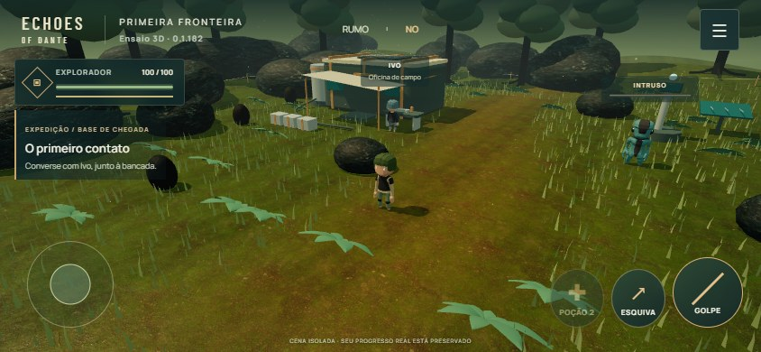

# Primeira fronteira · ensaio 3D · 0.1.182

Em 03/11/2026, depois de conhecer Keldurn e Last Havens, o usuário autorizou explicitamente a proposta de **um pequeno protótipo separado: trecho da base, personagem, NPC e inimigo** (“FAÇA ISSO PQ EU ACHO QUE ECHOES MERECE”). Essa autorização permite este experimento antes do próximo capítulo. Não declara a revisão visual 0.1.181 aprovada e não autoriza migrar toda a campanha.

[Abrir o ensaio](https://echosofdante.vercel.app/frontier-3d.html?v=0.1.182), registrado na biblioteca. Three.js 0.187.0/WebGL2 em uma entrada própria do Vite, sem carregar Phaser nem os sistemas/saves/relay da campanha. A campanha continua em Phaser, com as pinturas aprovadas. Protocolo cooperativo 16 preservado.

## O que está sendo avaliado

- Câmera de perspectiva que acompanha o explorador, órbita por arrasto e zoom, tratamento de obstrução por geometria sem tornar objetos transparentes. Geometria com volume, luz direcional/sombras, névoa, céu e materiais PBR.
- Clareira de chegada: habitat de metal/âmbar, toldo, reservatório/mangueira, bancada de Ivo, painéis solares e baliza. Rochas, raízes, plantas e perímetro de pesquisa com estacas/cabo. Caminhada bloqueada nos corpos sólidos; tubos baixos são transitáveis.
- Três modelos completos com rig e animações: explorador, técnico representando Ivo e criatura de referência. Caminhada/corrida, interação, golpe, rolamento e reação. Modelos CC0 de Quaternius, com paleta adaptada no runtime; **não são personagens definitivos de Dante nem aprovação de uma direção cartoon**. Cenário autoral usa a família de cores mineral/vegetação/metal gasto de Organic Sci-Fi R3 como ponto de partida. Não substitui arte aprovada.
- Um circuito curto: conversar com Ivo → afastar o intruso → examinar a baliza → retornar à bancada. Inimigo finito, cone de preparação com direção comprometida, investida e recuperação. Golpe, esquiva direcional com invulnerabilidade curta, duas poções e efeito visual de uso; morte/retorno preserva conquistas do ensaio. Não acrescenta HP, quotas ou esperas à campanha.
- Mouse/teclado, toque e gamepad padrão. Interface compacta, pausa, qualidade leve/equilibrada/detalhes, som breve opcional (desligado inicialmente) e sugestão de orientação dispensável no retrato. Não há nova trilha contínua neste experimento.

**Isolamento:** somente `sessionStorage['dante.frontier3d.v1']`, validação de entrada e fallback em memória se armazenamento falhar. Sem leitura/escrita dos personagens, preferências, missões, mapa, créditos ou recibos reais. Reload guarda a pesquisa, vida, poções e criatura derrotada, retornando à clareira; posição/câmera não são checkpoint da campanha. Reiniciar afeta somente este ensaio. Fechar a aba encerra a cópia temporária.

**Pré-requisitos simulados: nenhum.** É uma cena autônoma e começa do zero, não uma chegada avançada da campanha. Nenhum boss, região liberada, vitória, recompensa ou progressão real é criado. O explorador de referência é único; as quatro classes e duas apresentações da campanha não foram migradas. **Ensaio solo**, sem lobby/co-op novo. Não testa transporte da campanha ou duração da aventura. A referência ao Ivo é um papel de interação, sem substituir seu modelo/animação aprovada na base real.

## Controles

| Entrada | Movimento/câmera | Ações |
|---|---|---|
| Teclado/mouse | WASD/setas; arraste a cena para olhar; roda aproxima | Espaço ou clique breve: golpe; Shift: esquiva; E: interação; R: poção; Esc: pausa |
| Toque | Joystick esquerdo; arraste a área livre para olhar; dois dedos aproximam | Botões de golpe, esquiva, poção e interação contextual |
| Gamepad padrão | Esquerdo: movimento; direito: câmera | RT: golpe; B: esquiva; A: interação; Y: poção; Menu: pausa. D-pad/A navegam opções, B retorna |

## Implementação e orçamento

Geometrias estáticas são unidas por material na inicialização; grama e folhas usam instâncias. Vento na GPU; nenhuma rasterização/desenho de cenário estático por frame. Texturas PBR 1024² compartilhadas, fontes e modelos servidos pelo próprio domínio. Sem CDN de execução ou fontes externas. Pixel ratio limitado, qualidade leve sem sombras e renderização reduzida durante pausa. Colisão horizontal simples com círculos/AABB e subdeslocamentos limitados; não representa física de plataforma ou navegação final do mundo 3D.

Diagnóstico `?inspect=1` é opt-in e **somente leitura**: estado temporário, câmera, objetos e contadores. Não oferece teleporte, setters ou vitória simulada. O QA pode observar posição para escolher entradas de teclado; a progressão principal percorre o ensaio por inputs reais. Medição de FPS usa tempo real entre quadros, separada do dt limitado da simulação; contadores não equivalem a RAM total.

## QA e gates

- [x] Typecheck/build: 288 módulos, aviso de chunks grandes (Phaser existente e novo bundle 3D separado). Diff revisado. Modelos, fontes e seis texturas totalizam 6.908.933 bytes com manifestos/licenças; não é RAM/VRAM total nem transferência HTTP comprimida.
- [x] Circuito completo com teclado, aviso/dano/esquiva/poção, rocha/habitat, reload/criatura finita, pausa/qualidade/som, mouse, toque emulado e gamepad mock. [Roteiro](../../scripts/qa-frontier-3d.mjs), [DEV](qa/local/report.json), [compilado](qa/compiled/report.json). Compilado também confere câmera por gesto de toque e reinício explícito sem afetar saves reais.
- [x] Layouts 568×320, 844×390, 852×393, 915×412, 393×852, 1024×768 e 1920×1080; capturas inspecionadas pelo agente. Opções rolam dentro do diálogo, botões ≥44 px, sem overflow horizontal. Amostras de seis segundos em desktop: aproximadamente 59–60 FPS; 50–57 chamadas de desenho nas posições amostradas. Não é benchmark de celular, duração longa ou pior caso.
- [x] Compilado: [resiliência](qa/resilience/report.json). Fixtures explícitas de morte, JSON inválido, armazenamento bloqueado, download abortado e perda deliberada de contexto; mensagem de recuperação/reload e dados reais preservados. Todos os recursos observados são do próprio domínio; não carrega Phaser, campanha, API ou relay.
- [x] [Comparação de build](qa/build-verification.json): **86 hashes de JS/CSS/arte da publicação 0.1.181 permanecem idênticos**; fonte da campanha/rede/servidor não alterada. Acesso a este experimento não depende de disponibilidade do relay. Nenhuma exigência de rede/protocolo foi acrescentada.
- [ ] Endereço público e publicação da nova cena.
- [ ] Commit/push, igualdade local/remota e publicação conferida.
- [ ] Playtest humano em computador e iPhone 13/13 Pro: câmera, sensação de movimento, combate, identidade visual, calor/estabilidade. Não afirmar FPS mobile a partir de emulação. **Aguardar antes de ampliar a cena ou iniciar migração.**

Os ensaios técnicos não equivalem a uma jornada humana nem a testes em aparelho físico. A adoção de 3D exigiria decidir produção de modelos/animações originais, classes, câmera/controles, mapas, rede, progressão e orçamento mobile em etapas posteriores.

Durante o QA, um roteiro tentava ir em linha reta através da rocha e depois esperava um diálogo fechado ficar visível; foi corrigido para contornar o obstáculo e esperar o estado oculto. O teste de analógico foi movido para uma posição livre, pois junto ao habitat a colisão correta podia impedir o deslocamento exigido. Não foram enfraquecidas colisões para fazer os roteiros passarem. Revisão visual também corrigiu o ângulo/contraste do cone do intruso; ele acompanha a direção comprometida do golpe.

## Matrix-Game

O usuário confirmou o [Matrix-Game da Skywork](https://github.com/SkyworkAI/Matrix-Game). [Avaliação de viabilidade e insumo](MATRIX_GAME_EVALUATION.md): gravação limpa 1280×720 da cena, HUD separado e plano de comparação offline. **Nenhuma inferência neural executada**; a máquina consultada só apresentou Intel UHD, e não há servidor Linux/GPU NVIDIA disponibilizado. Este protótipo está usando Three.js convencional. Um futuro A/B com Matrix depende de infraestrutura compatível e avaliação de fidelidade ao Dante; não é uma melhoria visual já ligada nesta entrega.

## Fontes e licenças

[Proveniência dos modelos](../../public/assets/frontier-3d/sources.json), [materiais e hashes](../../public/assets/frontier-3d/materials.json), [aviso de licença](../../public/assets/frontier-3d/CREDITS.md).

Modelos Quaternius/CC0: [Ultimate Animated Character Pack](https://quaternius.com/packs/ultimatedanimatedcharacter.html) e [Alien](https://poly.pizza/m/HYUUkdugoP). Binários obtidos de espelho público com revisão fixada e SHA-256, preservados como distribuídos pelo espelho (incluem nó de ajuste `__fit`); não alegamos que são os binários originais do arquivo do autor. Geometrias, rig e clipes completos; adaptação da cor e escala ocorre no runtime.

Materiais ambientCG/CC0: [Ground037](https://ambientcg.com/view?id=Ground037) e [Rock035](https://ambientcg.com/view?id=Rock035). Downloads oficiais; somente Color, NormalGL e Roughness, convertidos em WebP quality 90 nas mesmas dimensões, retirando metadados sem repintura. Fontes Manrope e Barlow Condensed, Google Fonts, OFL incluída. Modelos e arte de WoW/Keldurn/Last Havens não são usados.
