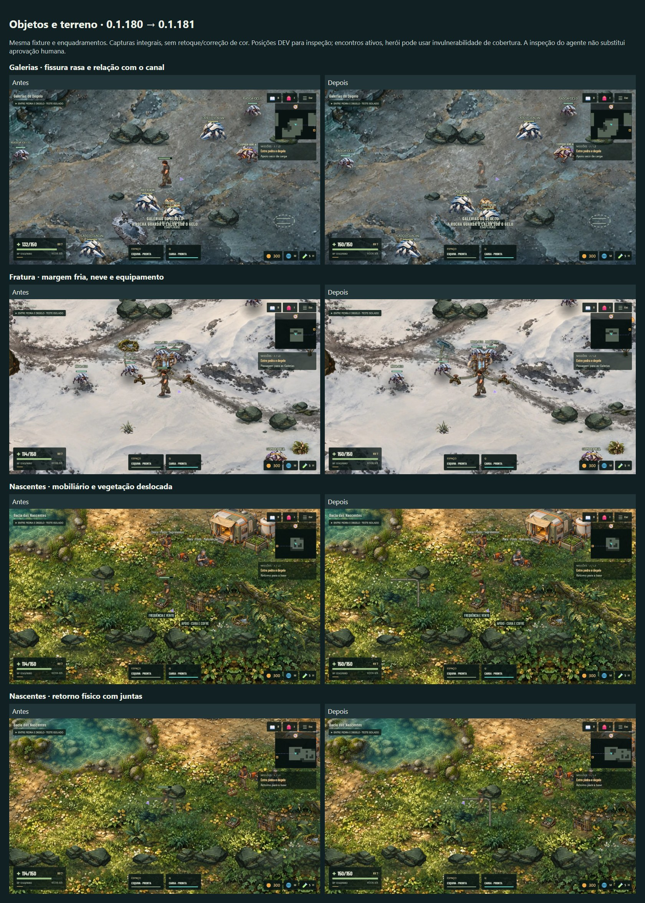

# Integração visual e opacidade · 0.1.181

Em 01/11/2026 o usuário aprovou a UX geral da 0.1.180 (“perfeito tudo certo”) e autorizou auditar e corrigir a etapa visual. Esta entrega fecha o seguimento V01–V05 da [auditoria original](../frontend-ux-audit-178/README.md), preservando Organic Sci-Fi R3/referência D, terrenos aprovados, personagens completos e a jornada original. Não inicia o Ninho de Vésper.

## Parecer e correções

| Item | Evidência/causa | Correção aplicada | Critério e limite |
|---|---|---|---|
| V01 · P2 · Fissura | Contorno fechado, placas altas e densidade de detalhe excessiva para o piso. | Asset próprio v2: depressão rasa, água com fundo visível, película de gelo e borda mineral fragmentada. Bake a 128² aproxima a densidade de texels do terreno; fonte maior é liberada após o bake. | Inspecionar junto ao herói, da margem e no mobile. Mesmos 190×215, âncora e escoamento; não cria parede, plataforma ou collider. Aprovação estética é humana. |
| V02 · P2 · Fratura | Coletor/válvulas sem reação da neve; análise a montante ainda usava nascente com raízes verdes. | Contato curto, neve comprimida e pequenas marcas de apoio; nascente fria recebe margem mineral/gelo. Mangueiras com juntas, sombra e volume discreto. | Dois registros e recipiente continuam operáveis. Nada verde acrescentado ao gelo; equipamento não é aumentado para compensar leitura. |
| V03 · P2 · Mobiliário | Mesma relação com o solo, inclusive sobre vegetação íntegra. | Apoio por material: terra usada com textura do piso aprovado, neve, pedra, areia e cinza. Base usa terra do acampamento; posto/Terraços usam a trilha da pradaria. Borda fragmentada e gradual. Carga/itens temporários recebem contato sem abrir clareiras por onde passam. | Silhuetas/origens preservadas. Companheiros acompanham visibilidade, opacidade própria, posição e destruição do objeto; nenhum resíduo após coleta. Amostras representativas, não inspeção individual de todas as combinações dos 36 tipos. |
| V04 · P2 · Tubulação | L cinza uniforme desenhado com Graphics; frente de pressão retangular. | Tubo físico rasterizado com cotovelo arredondado, colares, iluminação curta e contato. Pressão usa superfície molhada/spray com borda gradual; válvula e destino continuam reconhecíveis. | Mesmo ritmo/tempo/dano/área funcional da pressão. Tubo baixo não cria obstáculo invisível. Marcações de encaixe de carga mantêm sua função gráfica. |
| V05 · P2 · Transparência | Opacidade reduzida por cobertura (28%) e por proximidade das copas (40%). | Removidos os dois caminhos. Corpos ambientais conservam sua opacidade autoral e podem encobrir o herói por profundidade. Eliminados leitura de cobertura e loop de fade. | Não eleva o herói acima do cenário; portões continuam abrindo por tweens explícitos. Água, luz, folhas/partículas e materiais autorais translúcidos não são forçados a alpha 1. |

**Confiança:** causas técnicas verificadas no código; execução/estado medidos pelos roteiros; integração estética avaliada nas capturas pelo agente e ainda sujeita ao playtest humano. Passar no build não certifica aparência.

## Escopo e método de auditoria

[Prancha HTML reproduzível](qa/comparison.html). As imagens não recebem retoque de arte/cor; a prancha apenas apresenta as telas lado a lado.

- Fonte de partida `8749631`, aplicação 0.1.180; local/origin conferidos antes de editar. Revisão do renderer dos 36 tipos de quest prop, sete survey props, equipamentos independentes, tubulações, material/depth e dois mecanismos de fade. Sem troca das pinturas completas ou do enquadramento `icecave groundY:-300 / groundHeight:2300`; mapa físico 3100×1800 preservado.
- [Antes](qa/before/report.json) e [depois](qa/after/report.json): oito enquadramentos em sete mapas, desktop 1280×720 e 844×390. Base, Nascentes (posto/tubos), Terraços, Fratura, Galerias, Siroco e Dunas. Fixture antiga das Galerias carregada explicitamente; viagens/posições DEV somente para enquadramento, encontros presentes. Herói pode estar translúcido por invulnerabilidade da fixture; isso não é fade dos objetos.
- Laboratório novo: nove visitas em oito mapas, incluindo Floresta para copas. Dados temporários em namespace próprio; seleção normal de visita, navegação, opacidade, companheiros, reload e limites dos bosses. Perfil desktop sem toque e captura mobile não são aparelho físico.
- Física e arte: terrenos/obstáculos originais preservados, rotas de aproximação verificadas e capítulos exercitados com entradas reais. Formação rasa/tubos baixos não recebem novas paredes invisíveis; os equipamentos sólidos mantêm seus colliders. Não se presume que uma captura prova a navegação.
- Custo: texturas estáticas 256×128 compartilhadas por material/perfil, pipework único por rota e fissura 128². O update sincroniza transforms/visibilidade, sem desenhar pixels estáticos ou rasterizar por frame. Lista de companheiros é encerrada no shutdown; objeto destruído remove seu apoio. Sem nova medição de FPS, RAM, bateria ou tempo de campanha.

## Teste direto e simulações

[Abrir inspeção visual isolada](https://echosofdante.vercel.app/campaign-playtest.html?visual-review=1&v=0.1.181). Abra **OBJETOS E TERRENOS / LAB VISUAL** para escolher cada visita. [Versão com encontros comuns](https://echosofdante.vercel.app/campaign-playtest.html?visual-review=1&combat=1&v=0.1.181).

Cada escolha reinicia **somente a cópia temporária**: simula Warden/Soterrado, sete relatórios originais, doze capítulos anteriores, Bacia segura, acessos até as Galerias, 1350 XP e saldo inicial solo/anfitrião de 300 créditos. O convidado pode receber os créditos dos relatórios anteriores simulados pelas regras existentes, uma vez por recibo nessa cópia; a visita não concede a recompensa do capítulo atual. Coletor já instalado e carga atual retirada/preparada. Não simula as análises das Galerias, chegada da carga, mecanismo original, arquivo, seus 200 créditos ou vitória de Vésper/Incandescente. Atlas mantém os requisitos originais.

Encontros comuns ficam suspensos por padrão só nesse laboratório, sem registrar mortes/XP/drops; bosses não são suprimidos. O link opcional conserva encontros e permite avaliar o contexto do combate. Não confundir a visita de inspeção com uma jornada sem riscos no jogo real. No coop, crie a equipe pelo menu e envie o convite deste laboratório; o anfitrião prepara a visita com os integrantes reunidos. Convidado não pode preparar etapas.

Namespace `dante-visual-integration-v1.<classe>.`, isolado da campanha e de todos os laboratórios anteriores. Reload conserva a cópia nesta aba; reset/fechar a aba não alteram personagens, preferências, recibos ou progresso reais.

## QA técnico e aprovação humana

- [x] Capturas iniciais e revisão V01–V05; primeira versão dos apoios foi reduzida/refeita ao observar círculos de terra excessivamente uniformes. Asset gerado inspecionado antes de integrar.
- [x] Galerias completas na aplicação atual: análises por E, carga empurrada por cinco trechos com colisão na rocha e freio do degelo, recuperação, morte/R/reload, onze aproximações/portais originais, Vésper vivo e arquivo/entrega de Ivo com 200 créditos uma vez. Três retornos mantiveram contagens estáveis. [Regressão](qa/ice-regression/report.json).
- [x] Nove visitas em oito mapas no DEV; 32 corpos/copas amostrados, 19 com cobertura real da silhueta confirmada por alpha da textura, sem variação de opacidade ao aproximar/sair/retornar. Doze rotas de aproximação, visibilidade/apoio dos props e reload preservados. [Relatório](qa/lab/report.json), [herói atrás do abrigo](qa/lab/post-occluded.jpg), [sob a copa](qa/lab/forest-occluded.jpg). Posicionamento DEV é cobertura de renderer; não demonstra atravessar o collider de um corpo sólido.
- [x] Fratura: toque nas quatro classes, joystick respeitando o coletor, duas válvulas e lote real; gamepad emulado e layouts 568/844/1024/1920. [Relatório](qa/frost-controls/report.json). Fixture do checkpoint instalado, antes das válvulas, exportada pelo QA original; aproximações/classes explícitas, sem injetar os objetivos verificados.
- [x] Pressão ativa das Nascentes: [captura](qa/pressure/active-pressure-desktop.jpg), [relatório](qa/pressure/report.json). Aceite preparado pela API de Missions somente nessa cópia; ritmo/aviso pelo relógio normal, entrada por W e perda de vida 120→89 com criaturas presentes. Não isola os 18 pontos da descarga do dano dos inimigos; função de dano/tempo não foi alterada.
- [x] Dois Chrome separados no DEV, anfitrião desktop/convidado touch, relay real/protocolo 16: cinco áreas, opacidade medida em ambos, troca distante via base, reload/reentrada pelo personagem salvo, chat e encerramento normal. Saldos 300/1945 e recibos anteriores persistem após reload; nenhum recibo/recompensa do capítulo atual ou boss posterior. [Relatório](qa/coop-dev/report.json).
- [x] `npm run typecheck` e `npm run build`: 276 módulos, aviso existente de chunks grandes. `node --check` nos roteiros e `git diff --check`; capturas finais/prancha inspecionadas pelo agente.
- [x] Compilado sem globais DEV: nove visitas por toque real emulado, reload e saves reais preservados; seletor em sete viewports, nove botões com mínimo de 44 px, sem overflow horizontal/corte do painel. [Relatório](qa/compiled/report.json), [568×320](qa/compiled/selector-568.jpg), [393×852](qa/compiled/selector-393.jpg). O relatório identifica contexto touch; a rodada DEV e o anfitrião cooperativo cobrem desktop nativo.
- [x] [Verificação final](qa/verification.json): versões, PNG RGBA, links/evidências, pinturas/configurações de terreno preservadas em relação a `8749631` e oito snapshots de colliders. Variação de centros de trabalhadores ambulantes (raio 14) é registrada separadamente; demais sólidos e totais conservados. Texto comparado na forma canônica do Git (LF), imagens byte a byte.
- [ ] Publicação e solo/coop públicos, sincronização local/remota.
- [ ] Aprovação visual humana e reteste em iPhone 13/13 Pro. Emulação não substitui celular/gamepad físicos. Aguardar antes de novo capítulo.

Uma rodada inicial de inspeção com encontros ativos terminou com morte e perda normal de créditos na Floresta ([registro](qa/initial-active-encounters.json)). Motivou o modo tranquilo de inspeção, explicitamente separado do link com encontros; não foi corrigida a penalidade normal da campanha. Não há promessa de cobertura de cada distância/câmera/objeto ou de todo o combate cooperativo.

O primeiro teste de visitas cooperativas expôs a recusa correta do relay ao viajar entre regiões sem conexão direta ([registro](qa/initial-coop-adjacency.json)). O controlador exclusivo do laboratório passou a retornar pela base antes de preparar uma visita distante, conservando validação de viagem, catálogo e protocolo 16. Não foi aberto atalho na campanha nem alterado o servidor.

Os roteiros cooperativos foram ajustados para seguir o fluxo existente de reload → menu → convite → personagem salvo ([tentativa inicial](qa/initial-reload-menu.json)), e para abrir explicitamente o histórico de chat no desktop antes de exigir visibilidade da mensagem já recebida ([tentativa](qa/initial-chat-history.json)). Essas duas suposições do roteiro não foram tratadas como defeitos do jogo.

Código principal: [apoios/cache](../../src/visual/PropGround.ts), [tubos](../../src/visual/GroundPipe.ts), [fissura/cache](../../src/visual/MeltPocket.ts), [corpos ambientais](../../src/visual/EnvironmentArt.ts), [visitas](../../src/config/visualReview.ts). Arte/proveniência/prompt: [registro](art.md).
